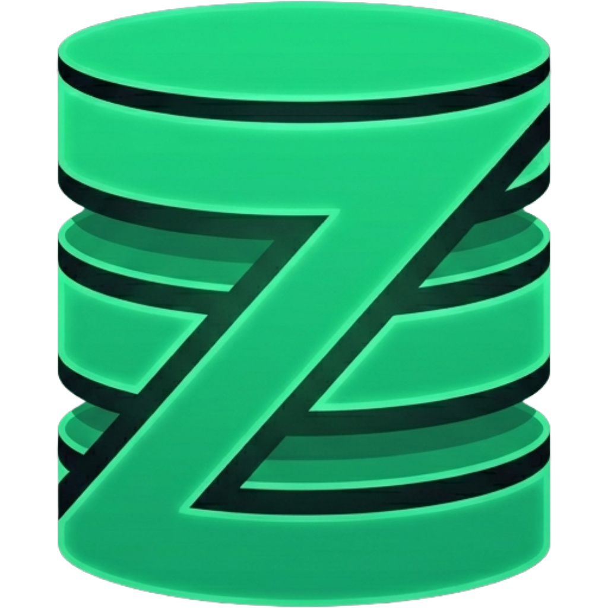

  

  <h1>ZBase Studio</h1>
  
<strong>One studio for every database engine you use.</strong>

  

    
    
    
    
    
    
  

  

    <a href="https://zsync.eu/zbase-studio/"><strong>⬇ Download Installers</strong></a> ·
    <a href="#engine-feature-comparison">Feature Matrix</a> ·
    <a href="#schema-builder">Schema Builder</a> ·
    <a href="#license">License</a>
  

---

ZBase Studio is a native cross-platform database GUI that lets you browse, query, edit, and design schemas across **five database engines** — all in a single app. Open a SQLite file, connect to a remote PostgreSQL cluster, and explore a DuckDB analytics file at the same time, each in its own tab.

> [!NOTE]
> Pre-built installers for Windows, macOS, and Linux are available at **[zsync.eu/zbase-studio](https://zsync.eu/zbase-studio/)** (13–25 MB, no runtime required).

---

## Table of Contents

Expand

- [Supported Engines](#supported-engines)
- [Engine Feature Comparison](#engine-feature-comparison)
- [Download](#download)
- [Opening a Database](#opening-a-database)
- [Browsing Data](#browsing-data)
- [Sorting & Filtering](#sorting--filtering)
- [Editing Data](#editing-data)
- [Query Editor](#query-editor)
- [Schema Tree (Sidebar)](#schema-tree-sidebar)
- [ER Diagram](#er-diagram)
- [Schema Builder](#schema-builder)
  - [SQLite Builder](#sqlite-builder)
  - [PostgreSQL Builder](#postgresql-builder)
  - [MySQL / MariaDB Builder](#mysql--mariadb-builder)
- [Stats Tab](#stats-tab)
- [Full-Database Search](#full-database-search)
- [Exporting Data](#exporting-data)
- [Importing Data](#importing-data)
- [Transactions (SQLite)](#transactions-sqlite)
- [Multi-Tab Workflow](#multi-tab-workflow)
- [License](#license)

---

## Supported Engines

| Engine | Version | Connection |
|---|---|---|
| **SQLite** | 3.x | Local file (`.db`, `.sqlite`, `.sqlite3`) |
| **DuckDB** | 1.x | Local file (`.duckdb`) |
| **PostgreSQL** | 13 + | Host / port / credentials |
| **MySQL** | 8.0 + | Host / port / credentials |
| **MariaDB** | 10.3 + | Host / port / credentials |

---

## Engine Feature Comparison

| Feature | SQLite | DuckDB | PostgreSQL | MySQL | MariaDB |
|---|:---:|:---:|:---:|:---:|:---:|
| Browse & paginate data | ✅ | ✅ | ✅ | ✅ | ✅ |
| Sort columns | ✅ | ✅ | ✅ | ✅ | ✅ |
| Filter columns | ✅ | ✅ | ✅ | ✅ | ✅ |
| Inline cell editing | ✅ | ❌ | ✅ | ✅ | ✅ |
| Add / delete rows | ✅ | ❌ | ✅ | ✅ | ✅ |
| Query editor | ✅ | ✅ | ✅ | ✅ | ✅ |
| ER Diagram | ✅ | ✅ | ✅ | ✅ | ✅ |
| Stats tab | ✅ | ❌ | ✅ | ✅ | ✅ |
| Full-database search | ✅ | ❌ | ✅ | ✅ | ✅ |
| Visual schema builder | ✅ | ❌ | ✅ | ✅ | ✅ |
| Export table | ✅ | ✅ | ✅ | ✅ | ✅ |
| Export whole database | ✅ | ✅ (copy) | ❌ | ❌ | ❌ |
| Import CSV | ✅ | ❌ | ❌ | ❌ | ❌ |
| Import SQL file | ✅ | ❌ | ❌ | ❌ | ❌ |
| Transaction bar | ✅ | ❌ | ❌ | ❌ | ❌ |

> [!TIP]
> DuckDB is intentionally read-only in v1 — it's optimized for analytics workloads, not row-level mutations.

---

## Download

> [!IMPORTANT]
> Download the latest release from **[zsync.eu/zbase-studio](https://zsync.eu/zbase-studio/)**.
> Installers are self-contained — no Java, no .NET, no Electron runtime required.

| Platform | Format | Size |
|---|---|---|
| **Windows x64** | NSIS installer (`.exe`) | ~13 MB |
| **Windows x64** | MSI package (`.msi`) | ~18 MB |
| **macOS Apple Silicon** | Disk image (`.dmg`) | ~23 MB |
| **macOS Intel x64** | Disk image (`.dmg`) | ~25 MB |
| **Linux x64** | `.deb` / `.rpm` | ~25 MB |
| **Linux x64** | AppImage | ~98 MB |

SHA-256 checksums are provided alongside every release.

---

## Opening a Database

Click the **`+`** button in the tab bar to open the connection chooser.

### SQLite & DuckDB — File-based

Pick any `.db`, `.sqlite`, `.sqlite3`, or `.duckdb` file. ZBase Studio detects the engine automatically.

### PostgreSQL

Fill in Host, Port (`5432`), Database, User/Password, and SSL Mode (Disable / Prefer / Require).

### MySQL

Fill in Host, Port (`3306`), Database, and User/Password.

### MariaDB

Same form as MySQL, default port `3307`.

### SQLite Templates

Don't have a database yet? Choose a built-in starter schema:

| Template | Tables |
|---|---|
| **Blog** | users, posts, comments with foreign keys |
| **E-Commerce** | customers, products, orders, order items |
| **Inventory** | suppliers, items, locations, stock levels |
| **Task Tracker** | projects, tasks, tags, task tags, users |

Templates open as a draft tab — edit the schema, then save to a new `.db` file.

### Open from CSV

Pick a `.csv`, `.tsv`, or `.txt` file. ZBase Studio auto-detects the delimiter, infers column types, and imports into a new or existing SQLite database.

### Open a SQL script

Pick a `.sql` file — small scripts load into the query editor; large scripts execute directly against a database.

---

## Browsing Data

Click any table in the sidebar to open it in the **Data** tab.

- **200 rows per page** — navigate with **Prev** / **Next** in the footer
- Footer shows current range and estimated total (e.g. *"1–200 of ~12,450"*)
- `NULL` values appear in italic gray — visually distinct from empty strings
- Right-click any cell: **Copy cell**, **Copy row as JSON**, **Copy row as CSV**

---

## Sorting & Filtering

### Sorting

Click any **column header** to cycle sort states:

1. Click once → **Ascending** ▲
2. Click again → **Descending** ▼
3. Click again → **Cleared**

### Filtering

Click the funnel icon in a column header to open the filter popup.

Available filter operators

| Operator | Meaning |
|---|---|
| `=` | Exact match |
| `!=` | Not equal |
| `<` | Less than |
| `<=` | Less than or equal |
| `>` | Greater than |
| `>=` | Greater than or equal |
| `LIKE` | Pattern match (`%` and `_` wildcards) |
| `IS NULL` | Cell is null |
| `IS NOT NULL` | Cell is not null |

Multiple filters can be active simultaneously. Active filters appear as **chips** above the grid — click **×** on a chip to remove it.

---

## Editing Data

> [!WARNING]
> Editing is available on **SQLite, PostgreSQL, MySQL, and MariaDB** only. DuckDB is read-only.

Click **Edit** in the data grid toolbar to enter edit mode.

| Action | How |
|---|---|
| Edit a cell | Click it |
| Move to next column | <kbd>Tab</kbd> |
| Commit edit | <kbd>Enter</kbd> |
| Cancel edit | <kbd>Escape</kbd> |
| Add a row | Click **Add Row** |
| Delete rows | Check rows → **Delete (N)** |

---

## Query Editor

The **Query** tab is powered by Monaco (the VS Code editor engine).

- SQL syntax highlighting, 100+ keyword autocomplete, table/column suggestions
- Run with the **Run** button or <kbd>Ctrl</kbd>+<kbd>Enter</kbd> (<kbd>⌘</kbd>+<kbd>Enter</kbd> on macOS)
- Results panel: row count, execution time, virtualized grid, NULL display, error messages
- Per-tab query history (up to 200 entries, session-scoped)
- Query content is auto-saved per file path and restored on next open

---

## Schema Tree (Sidebar)

The left sidebar shows the live schema for the active tab:

- **Tables** — row count badge; click to open in Data view
- **Views** — openable in Data view (read-only)
- **Triggers** — listed for reference

Right-click a table:

| Item | Engines |
|---|---|
| Edit Table… | SQLite only |
| Open in Schema Builder… | PostgreSQL, MySQL, MariaDB |
| Export table… | All |
| Copy table name | All |

---

## ER Diagram

The **ER Diagram** tab renders your full schema as an interactive node graph.

- Tables as cards — column names, types, **PK** (yellow) and **FK** (cyan) badges
- Lines connecting tables with FK relationships, labeled `col → referenced_col`
- Drag nodes to rearrange — positions persist per tab
- **Auto Layout** button, mini-map, zoom, and pan controls

Available on all five engines.

---

## Schema Builder

ZBase Studio includes a full visual schema designer with live DDL preview and diff-based apply.

---

### SQLite Builder

A **standalone draft tab** — design from scratch, then save. Or clone an existing schema via **Edit Schema in Builder…**.

Column options

- Type: INTEGER, TEXT, REAL, BLOB, NUMERIC, BOOLEAN, DATE, DATETIME, or any custom type
- Constraint chips: **PK**, **AI** (autoincrement), **NN** (not null), **UQ** (unique)
- Foreign key: referenced table/column, ON DELETE/UPDATE actions
- DEFAULT expression, CHECK expression, COLLATION (BINARY, NOCASE, RTRIM)

- Composite primary key, table-level CHECK constraints
- **WITHOUT ROWID** and **STRICT** mode toggles
- Indexes (UNIQUE, partial WHERE clause), Views, Triggers
- Full undo/redo — <kbd>Ctrl</kbd>+<kbd>Z</kbd> / <kbd>Ctrl</kbd>+<kbd>Shift</kbd>+<kbd>Z</kbd>
- **Save Database…** executes all DDL and promotes the draft to a live tab

---

### PostgreSQL Builder

Live diff against the server — changes are applied as `ALTER` statements in a single transaction.

> [!CAUTION]
> Destructive operations (DROP TABLE, DROP COLUMN) show a confirmation dialog listing every affected object. You must check *"I understand these changes may delete data"* before Apply becomes clickable.

Supported PostgreSQL types

| Category | Types |
|---|---|
| Integer | SMALLINT, INTEGER, BIGINT |
| Numeric | NUMERIC(p,s), REAL, DOUBLE PRECISION, MONEY |
| String | TEXT, VARCHAR(n), CHAR(n) |
| Date/Time | DATE, TIME, TIMETZ, TIMESTAMP, TIMESTAMPTZ, INTERVAL |
| Boolean | BOOLEAN |
| Other | BYTEA, JSON, JSONB, UUID, INET, CIDR, MACADDR |
| Custom | Any type name |

Array types supported via checkbox (`[]`).

- IDENTITY columns, GENERATED ALWAYS AS STORED columns
- FK with DEFERRABLE / INITIALLY DEFERRED
- Table-level UNIQUE, CHECK, FK constraints
- UNLOGGED / TEMPORARY table toggles, table COMMENT
- Indexes: btree, hash, gin, gist, brin, spgist — expression columns, NULLS FIRST/LAST, partial WHERE
- Materialized views, Functions (plpgsql/sql), Triggers, Enums

---

### MySQL / MariaDB Builder

Same apply/confirm mechanics as the PostgreSQL builder.

Supported MySQL / MariaDB types

| Category | Types |
|---|---|
| Integer | TINYINT, SMALLINT, MEDIUMINT, INT, BIGINT |
| Decimal | DECIMAL, FLOAT, DOUBLE |
| String | CHAR, VARCHAR, TINYTEXT, TEXT, MEDIUMTEXT, LONGTEXT |
| Binary | BINARY, VARBINARY, TINYBLOB, BLOB, MEDIUMBLOB, LONGBLOB |
| Date/Time | DATE, TIME, DATETIME, TIMESTAMP, YEAR |
| Other | BIT, JSON, ENUM, SET, GEOMETRY, POINT, LINESTRING, POLYGON |
| MariaDB only | UUID, INET4, INET6 |

- NOT NULL, AUTO_INCREMENT, DEFAULT, UNSIGNED, ZEROFILL, ON UPDATE CURRENT_TIMESTAMP
- GENERATED AS (STORED / VIRTUAL), per-column CHECK, per-column COLLATION
- INVISIBLE flag (MariaDB only), COMMENT, ENUM/SET value lists
- Table options: ENGINE (InnoDB, MyISAM, Aria…), DEFAULT CHARSET, COLLATE, ROW_FORMAT, AUTO_INCREMENT
- Indexes: BTREE, HASH, FULLTEXT, SPATIAL — functional indexes, prefix length, ASC/DESC
- Views, Triggers, Stored procedures, Functions

---

## Stats Tab

Click **Refresh** to load database statistics.

> [!NOTE]
> Stats are available on SQLite, PostgreSQL, MySQL, and MariaDB. DuckDB does not expose this data.

SQLite stats

- Page count, total size on disk, free pages, reclaimable space, page size, journal mode
- **Integrity check** — green "passed" or a red list of errors
- Per-table row count

PostgreSQL stats

- Total database size, table count, total row estimate
- Total dead tuples (hint to run VACUUM)
- Per-table: schema, name, rows, data size, index size

MySQL / MariaDB stats

- Default character set, table count, total row estimate, total data size
- Per-table: name, storage engine, rows, data length, index length

---

## Full-Database Search

The **Search** tab scans every table for any text value. Available on SQLite, PostgreSQL, MySQL, and MariaDB.

- **Case-sensitive** toggle and **Regex** toggle
- Results stream in real time as they are found
- Cancel at any time — results capped at **10,000 hits**
- Virtualized result list — smooth scrolling with thousands of results
- Each result shows: table name, column name, row number, matched value

---

## Exporting Data

### Single table

Click **Export** in the toolbar, or right-click a table → **Export table…**

8 supported formats

| Format | Notes |
|---|---|
| CSV | Standard comma-separated, UTF-8 |
| CSV (Excel) | Semicolon-separated with BOM |
| TSV | Tab-separated |
| JSON | Array of row objects |
| SQL Dump | CREATE TABLE + INSERT statements |
| XML | Row-based XML document |
| YAML | Array of mappings |
| Markdown | Pipe-table format |

Export is streamed with a live row counter — large tables are safe to export.

### Entire SQLite database

Right-click a tab → **Export Database…**

- **SQL Dump** — structure + data, with DROP/IF NOT EXISTS/transaction/FK-check options
- **SQLite binary backup** — byte-perfect copy using SQLite's online backup API

---

## Importing Data

### From CSV

**`+`** → **From CSV…** → pick file → preview/configure columns → choose target database → import with live progress.

### From SQL script

Open a `.sql` file via file picker — small scripts load into the query editor; large scripts execute directly.

> [!NOTE]
> MySQL-only statements in a script are detected and skipped automatically. A toast reports how many were skipped.

---

## Transactions (SQLite)

Run `BEGIN` in the query editor to enter transaction mode:

- Amber **"Transaction open"** bar at the bottom
- **TXN OPEN** badge in the title bar
- Amber dot on the tab
- **Rollback** or **Commit** buttons to finalize

---

## Multi-Tab Workflow

Every database lives in its own tab — open as many as you need simultaneously.

| Badge | Engine |
|---|---|
| 🟡 **DuckDB** | Yellow |
| 🔵 **PG** | PostgreSQL |
| 🟢 **MY** | MySQL |
| 🟣 **MD** | MariaDB |
| 🔵 **draft** | SQLite builder draft |
| *(none)* | SQLite |

Right-click a tab: **Export Database**, **Open in file manager**, **Close tab**.

---

## License

ZBase Studio is released under the **GNU General Public License v3.0**.
See [LICENSE](LICENSE) for full terms.

---

  
    Download at <a href="https://zsync.eu/zbase-studio/">zsync.eu/zbase-studio</a> ·
    Built by <a href="https://github.com/TheHolyOneZ">TheHolyOneZ</a> ·
    <a href="https://zsync.eu">zsync.eu</a>
  

